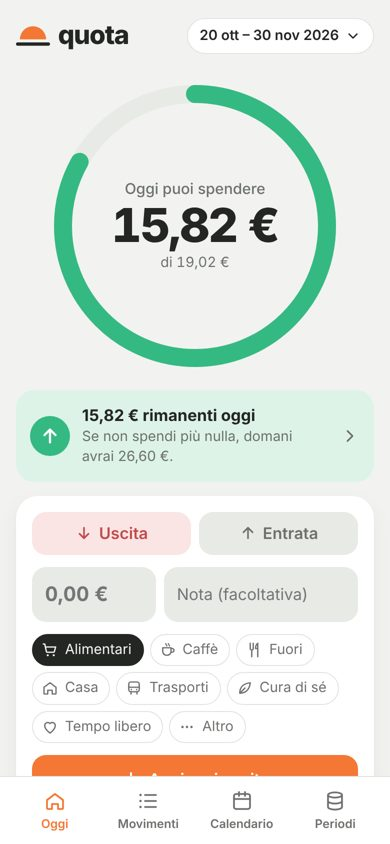
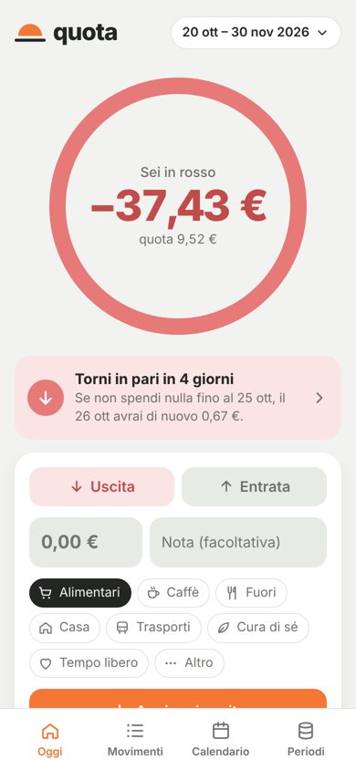
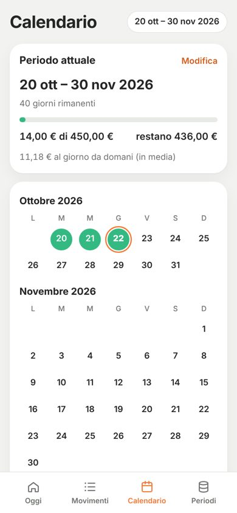
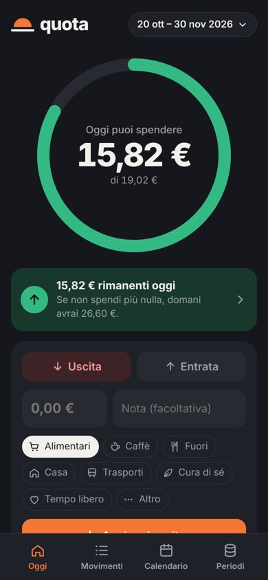

<h1 align="center">quota</h1>

<i>Ogni giorno, il tuo equilibrio.</i>

<a href="https://sandras-apps.github.io/quota-app/"><b>Apri l'app →</b></a>

  
  
  
  

Quota è un'app di budget giornaliero. Scegli un periodo (per esempio da uno stipendio all'altro) e quanti soldi hai: l'app li divide per i giorni e ti dice **quanto puoi spendere oggi**.

- Quello che non spendi oggi **si aggiunge a domani**.
- Se sfori, scegli tu cosa succede (in *Periodi*):
  - **Recupera**: la quota resta uguale, vai in negativo (es. −37,43 €) e l'app ti dice quanti giorni senza spese servono per tornare in pari.
  - **Ricalcola**: quello che resta viene ridiviso sui giorni che mancano, così arrivi sempre a fine periodo.
- Le **entrate** vengono divise tra i giorni che restano.
- Calendario con tre stati riconoscibili anche dalla forma: cerchio pieno (in quota), cerchio vuoto (zero spese), cerchio con punto (sforato).
- Tema chiaro e scuro automatici, funziona **offline**, si installa sulla schermata Home.
- Gratuita, **senza account**: i dati restano sul telefono.

## Installarla
- **Android:** apri il link in Chrome → ⋮ → **Installa app**.
- **iPhone:** apri il link in Safari → Condividi → **Aggiungi alla schermata Home**.

## Cambiare telefono
1. Sul vecchio telefono: *Periodi → Backup → **Invia backup*** e mandati il file (WhatsApp, email, Drive).
2. Sul nuovo telefono: apri l'app e tocca **"Hai cambiato telefono? Carica il tuo backup"**.

## Struttura

| File | A cosa serve |
|---|---|
| `index.html` | Struttura dell'app (Oggi, Movimenti, Calendario, Periodi) |
| `style.css` | Colori, font e layout, tema chiaro e scuro |
| `app.js` | Logica: periodi, movimenti, quota, riporto, backup |
| `manifest.webmanifest` | Nome, colori e icone per l'installazione |
| `sw.js` | Service worker per l'uso offline |
| `icons/` | Logo e icone |
| `docs/` | Schermate per questo README |

Nessuna build: è HTML, CSS e JavaScript puro, pubblicato con GitHub Pages dal branch `main`.

## Aggiornare l'app
Dopo ogni modifica, in `sw.js` aumenta il numero in `const VERSION = 'quota-v3';` (`quota-v4`, `quota-v5`…), così i telefoni scaricano la nuova versione.

## Identità

| Colore | Chiaro | Scuro |
|---|---|---|
| Sfondo | Grigio nuvola `#F2F3F1` | Notte `#15171C` |
| Testo | Grafite `#242624` | Gesso `#F1F0EC` |
| Accento | Arancio vivo `#F47735` | `#F47735` |
| In quota | Menta `#35B982` | `#35B982` |
| In rosso | Corallo tenue `#E77979` | `#E77979` |

Font: **Plus Jakarta Sans** (titoli e cifre) e **Inter** (testi).
Logo: un sole che sorge sull'orizzonte, la quota come punto di equilibrio.
